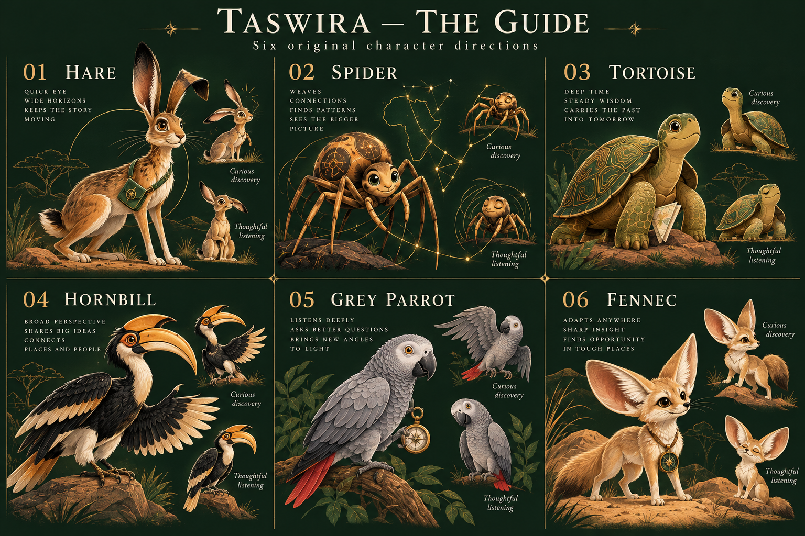
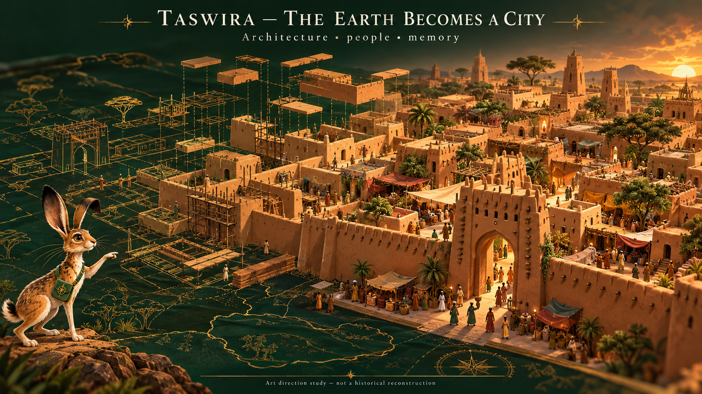
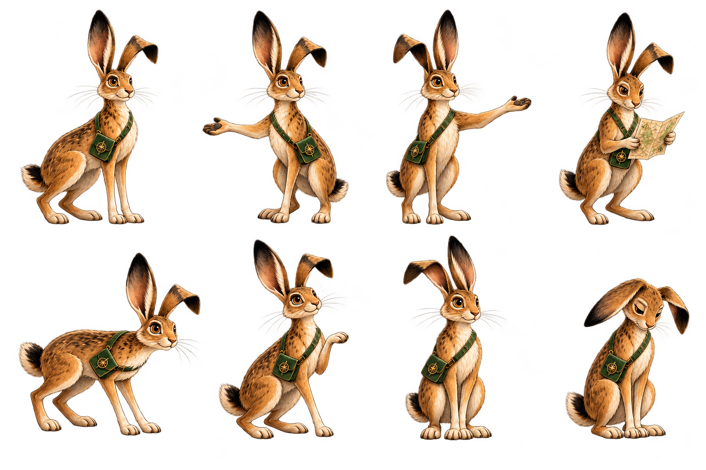

# Taswira: immersive-story handoff to Claude

Saifu's direction, 27 October 2026. Read AGENTS.md and the shared repository instructions
first. This handoff records the maintainer's creative decisions and the work delivered
in the current history PR. It is not permission to merge, deploy or edit protected files.

## The film we are making

Taswira is an authored, sourced African history story carried by a moving atlas. Geography
opens the question; people, work, exchange, belief and political choices move the story.
Give each act an opening question, a change the viewer can feel, and an ending that makes
the next act matter. Keep the forest green, ivory, antique gold and Georgia identity.

The distinctive combination should be: a fictional Hausa-rooted guide, architectural worlds
that assemble on the map, named local voices and traditions, and a factual timeline whose
evidence remains one click away. Borrow sequencing/construction techniques from admired
films/channels; do not reuse their art, characters, music, scripts or visual trademarks.
The project is ambitious; “first of its kind” and unmatched market performance are aspirations,
not researched claims or guarantees.

## Decisions Saifu actually made

- Green/gold/Georgia across the whole website; fluid, flashy and catchy animation is essential.
- Architecture should develop into whole complexes/cities, with walls, courts, buildings,
  gates and bridges where documented. Single rising monument icons are insufficient.
- A recurring animal narrator/guide should appear around the visuals. After reviewing six
  original concepts, Saifu selected the **hare direction**. **Zomo** is the working name.
- African and especially Hausa literature, lore and material culture must shape the identity.
  The supplied interlaced knot images are a research/design lead.
- The information/navigation panel must be hideable so the timeline can play as cinema.
- Keep improving through concrete visual reviews; a test count alone is not the artistic bar.

## What exists now: inspect the actual player

The current source extends Act 1 from PR #52, based on the already merged fixes/green design.
Use the PR's current head; main does not receive these changes until Saifu merges it.

Implemented:

1. **Details** hides/restores the history information panel without resetting scene time.
   **Cinema** also hides long chapter navigation; date/scene narration, caveats, timeline,
   pause/step controls and the return controls remain visible. **Full screen** requests native
   browser fullscreen with Cinema as fallback. Escape restores the cinema layout.
2. The live conflict map also has a desktop/phone panel toggle with a compact filter summary
   and attribution. Do not remove data meaning when hiding the filters.
3. Zomo's original transparent pose atlas is bundled by the history build. Entrances, pose
   changes, gentle movement and stillness use scene time. The guide can be hidden separately.
   Sensitive/campaign scenes get a still solemn pose. There is **no recorded voice yet**.
4. Three architectural settings assemble in independently timed parts: Meroe royal cemetery,
   Aksum stelae/tombs, Great Zimbabwe hill/enclosure/domestic structures. Responsive local SVG
   groups preserve the map's geographic anchor and the deterministic export clock.
5. These are **symbolic architectural illustrations**, not surveyed plans or measured city
   reconstructions. Counts, placement and reveal order are illustrative. No bridge is invented
   for these three sites. Current source checks do not justify a complete intact skyline at a
   single date for every component, especially Aksum's much later palaces/churches.
6. Video capture accepts an explicit reviewed shot manifest. The storycraft proof selects
   the three new settings; the older four-shot pilot remains the default when no plan is supplied.
7. Research inventories and a motif catalogue separate cultural motifs, dated objects,
   documented political emblems and original editorial identifiers. These are different roles.

### Review files

- `previews/storycraft.html`: actual interactive player, opens Great Zimbabwe in Cinema.
- `previews/storycraft-video.html`: offline 35-second 1080p60 viewing copy, with MP4 download.
- `previews/site-theme.html`: updated history and conflict-map controls, existing data snapshot.
- `previews/motif-catalogue.html`: eight sourced cultural directions and the original knot study.

Download an HTML with GitHub’s **Download raw file** button, then open the saved file in a
current browser. GitHub’s source-code viewer does not run the player.

### Run and check

```
python -m unittest discover -s tests
python build_history.py --output <scratch-history.html>
node tests/history_storycraft_browser.cjs <scratch-history.html> <local-dependency-directory>
node tests/history_africa_browser.cjs <scratch-history.html> <local-dependency-directory>
node tests/history_video_browser.cjs <scratch-history.html> <local-dependency-directory>
node tests/history_browser.cjs <scratch-history.html> <local-dependency-directory>
node capture_history.cjs <scratch-history.html> <local-dependency-directory> <new-output.mp4> 60 8 history/cuts/storycraft-pilot.json
```

The exporter needs Playwright, Chromium, ffmpeg and the checked local dependencies. Do not
commit a generated docs/history.html or silently publish a draft. Windows users can build
and open the page using the existing Python workflow. Preview HTMLs bundle dependencies for
convenience; source templates keep their normal build pipeline.

## Zomo: character bible for the next pass

An original contemporary fictional guide, informed by documented Hausa hare/trickster
traditions. The hare is not an ethnic flag, a historical witness or a spokesperson for all
African peoples. Keep the selected tawny coat, long black-tipped ears, emerald map satchel
and modest brass compass. Avoid a collection of unrelated ethnic costumes or sacred regalia.

Personality: observant, curious, quick-witted, willing to revise a claim. Let the humor come
from discovery, scale and the guide's own small misunderstandings. Never make killing,
enslavement, famine, displacement, atrocity or the people enduring them into comedy.

Purposeful actions: unfold a map; point toward a river bend; notice a gate detail; draw attention
to a source; listen to a named speaker; step aside when human testimony should lead.
Use occasional entrances and specific reactions. Avoid constant bouncing, fake lip-sync,
forced catchphrases, or pretending that every transition needs a gag.

The PNG atlas is a working prototype, **not a finished puppet rig**. The walking/crouch pose
crosses its cell and is omitted in live use; the adjacent discovery pose has a CSS inset to
remove spill. Read history/art/README.md. A production vector or mesh rig needs a turnaround,
clean separated parts, pose consistency, reusable gesture cycles and a neutral serious pose.
Do not declare all eight atlas cells finished animation states.

Voice direction is proposed, not chosen: warm, assured and curious; adult documentary clarity,
with space for human voices and Hausa words reviewed by Hausa speakers. Do not imitate an
existing narrator or assume a generic African accent. Record a short casting sample before
locking the voice, then time scenes/captions to that delivery. The present proof is silent.

## The supplied Hausa knot: use the evidence precisely

The research confirms its value as a Hausa/northern Nigerian cultural design lead. It does
not establish any supplied variant as a medieval flag or seal of every Hausa kingdom.

- Lam Museum's mid-twentieth-century shoes discuss older knot traditions and *tentative* medieval
  trans-Saharan links. UBC's robe is catalogued “Before 1910?” with uncertainty retained.
- Nigerian historian Moses Ochonu's 2008 article specifically dates modern political adoption
  of Dagin Arewa to the **1950s** under Ahmadu Bello. That does not date the invention of all
  interlace or supply a standard medieval drawing.
- An original knot can frame a cultural chapter as an **editorial cultural identifier**.
  Its role must differ visibly/structurally from dated political flags in actor data.
- Kano, Katsina, Daura, Zazzau, Gobir, Rano and Biram are not one undifferentiated actor. A shared
  cultural frame can accompany separate cities; each claimed historical insignia needs its own
  evidence. No “seven loops mean seven kingdoms” explanation was verified.

The original SVG study is in history/art, outside the dated actor drawing registry. Keep that
separation until a dated political use is documented. The motif catalogue records permissible
uses and limits; it is a research/design catalogue, not automatic timeline authority.

## Lore is a story layer with its own evidence

Use a recognizably different frame when moving into oral tradition: an attributed telling,
a named community/language, a source/version and an on-screen **Oral tradition** label.
The factual year counter must not invent a date for a folktale.

- **Daura, Daurama, Bayajidda and Kusugu:** a water/well/serpent/queen sequence can show the
  importance and structure of an origin tradition. Credit its selected local telling. Do not
  turn the tale into proved migration genealogy or the single literal founding of all Hausa.
- **Amina of Zazzau:** make the difference between remembered authority and disputed chronology
  part of the story. The Kano Chronicle placement and later post-1576 reconstruction conflict.
  Do not infer a precise conquest map, portrait, armor or personal emblem from fame.
- **Gizo and Zomo:** retain their distinct recorded tellings. The rope tug-of-war checked in
  Shaihu/Rattray belongs to Gizo; do not casually reassign it to the hare. A metaphorical story
  about manipulation must not become an explanation of an actual war.
- **Bori:** living religious history, not a generic fantasy bestiary. The checked 2024 abstract
  is not a license or enough evidence to invent a spirit hierarchy, costume or performance.

Credit Hausa contributors such as Malam Shaihu and named tellers such as Umoru Gombe, rather
than only colonial collectors/translators. The research inventories explain mediation,
retrieval limits and rights. Modern illustrated retellings are not free source art.

## The next flagship scene: “The earth becomes a city”

Build one carefully sourced Hausa city sequence before broadening the same treatment to
every site. The concept image expresses the target **density and narrative scale**. Its
broader Sahelian shapes are not evidence for a dated Kano skyline; do not trace it into a
historical reconstruction. Work with Hausa architectural references and local expertise.

A proposed 35–45 second sequence:

1. **0–5s: a question in the landscape.** Wind and a long view; Zomo follows a road toward
   the chosen site. Narration asks how earth, water, work and exchange sustain a city.
2. **5–12s: ground lines become a place.** Trace an evidence-based or explicitly schematic
   plan. Earth walls rise in courses; gates have distinct material and profile.
3. **12–22s: people give the plan purpose.** Courtyards, market/craft spaces and an evidenced
   civic/religious landmark enter separately. A short human action explains why one matters.
4. **22–30s: culture becomes a visual connection.** A documented textile/design detail can
   match-cut to architectural ornament. Show an original cultural-frame interlace outside
   historical flags; this is an editorial transition, not evidence of a medieval state logo.
5. **30–38s: reveal and consequence.** Pull from a local architectural view back to separate
   cities and their documented links. Zomo guides attention, then becomes still for the hold.
6. **38–45s: an open door.** End on a question that belongs to the following scene, not an
   encyclopedia conclusion. An optional attributed Daura tradition is a separately marked inset.

For a bridge, choose an actual documented crossing with a date, material, function and source
before modeling it. The next railway/port acts may offer good candidates. A medieval-style
bridge must not be placed in Kano, Meroe, Aksum or Great Zimbabwe merely for visual drama.

## Motion and sound grammar

Authored beats should drive the clock: orient → trace → assemble → human action → reveal → hold
→ depart. Add explicit caption/voice cue times; equal sentence slots are still a temporary
reading heuristic. Shape each camera move around an action, not a constant identical zoom.

Create depth with layered local sets, elevation, material, light and restrained camera travel;
retain a true map anchor. Use original sound design for wind, water, clay, stone and footsteps.
Any actual music/instrumental performance needs its own cultural context, artist and licence.
Avoid an undifferentiated “African drums” loop. Silence and human testimony are essential
parts of the sound palette in passages about suffering. Nothing in this delivery clears an
external music track, voice recording, oral performance or photograph for reuse.

## Evidence and next priorities

Read in order:

1. history/research/creative/project-review.md — pre-upgrade product/technical review and remaining gaps.
2. history/research/creative/hausa-lore-and-knot.md — detailed Hausa sources and five story directions.
3. history/research/creative/african-visual-evidence.md — Edo, Yoruba, Igbo, Cross River, Akan and architecture.
4. history/research/creative/mascot-options.md — alternatives and source register; hare is now selected.
5. history/motifs.json — concise role/use/limit catalogue; source inventories remain authority.

Immediate priorities after Saifu reviews this proof:

- Complete a clean Zomo rig and a short voice test; get cultural/pronunciation feedback.
- Choose one Hausa city and one evidenced period; research its building phases, craft life,
  water, gates and local institutions. Then deliver a full city scene to the same review bar.
- Build Acts 2/3 as narrative history, bringing Hausa and neighboring societies into normal
  playback. The current map-key chapter remains reference-only; decorating it is not a
  substitute for the missing regional narrative.
- Replace reading-based captions with authored cue times or recorded narration timing.
- Profile real phones; keep many buildings inside a small number of SVG/canvas groups.
  The current PNG atlas adds about 3 MB to the bundled history data. Future production asset
  loading/caching can reduce repeat transfer while preserving offline preview convenience.
- Continue British colonisation/resistance, railways/ports, independence/Civil War only after
  their source gates. Campaign stops and captured towns must agree with the shared clock;
  fronts remain dated snapshots. Human consequences get their own space.

No merge, deployment, main edit, protected instruction change, or Claude-branch overwrite was
performed for this work. Saifu remains the reviewer and merger. Keep the visual work that
already moves; improve it through actual timed previews, not by stripping motion for export.

## Visual references included in this delivery

These are original direction studies, not historical evidence. The working player is the
authoritative proof of implemented motion; the richly illustrated city image is a target
for later production quality and needs place/period-specific architectural review.







### Original casting sample, not a historical quotation

“A map gives us a place to start. Follow the river, then look beyond it: the fields, the
workshops, the roads, the rooms where people traded, argued and imagined their future.”

A light geographic transition could try: “I brought a map. The river brought surprises.”
These are new script proposals, not Hausa proverbs or quotations. Test the delivery with
the selected character, then retain only what fits the film's tone.

## Verification and remaining limits

The build validates 5 chapters, 45 scenes and 88 source records. All 75 Python tests pass.
The actual player passed all 270 desktop/phone × scene × jump/play/reduced-motion cases,
with no page errors and Esri requests confined to explicit modern references. Separate
checks cover dated campaigns, reference-skipping playback, exact repeated globe/map/
snapshot/campaign/city frames, revised Africa cameras, hidden-panel context, and video exit.

The 35-second proof was rendered with Chromium/ffmpeg. ffprobe reports H.264,1920×1080,
60 fps and 2,100 frames; the embedded viewing copy was played offline in Chromium. The
new phone guide/site-label overlap test was observed failing, then passing after the layout fix.
Independent source review identified missing Cinema feature warnings, a clipped walking
pose and incomplete hidden-map context; these were corrected or, for the pose, omitted.

These are desktop Chromium and emulated phone checks, not profiling on a physical phone
or testing every browser. The PNG pose atlas remains a prototype. Full city reconstruction,
recorded narration, original cleared sound design, historian/cultural feedback and final
publication rights review remain future work. The concept illustration is not the current
renderer’s visual output.
